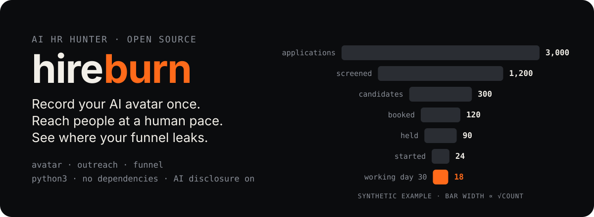
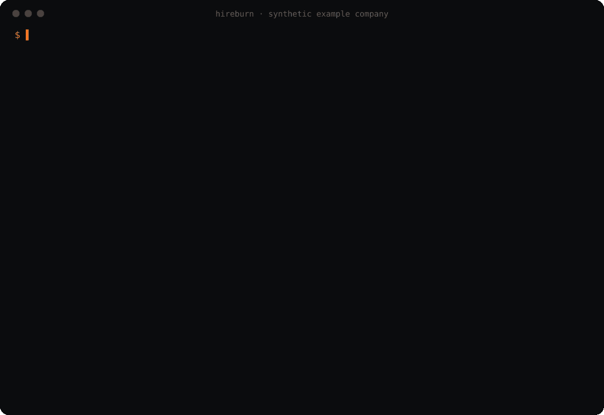
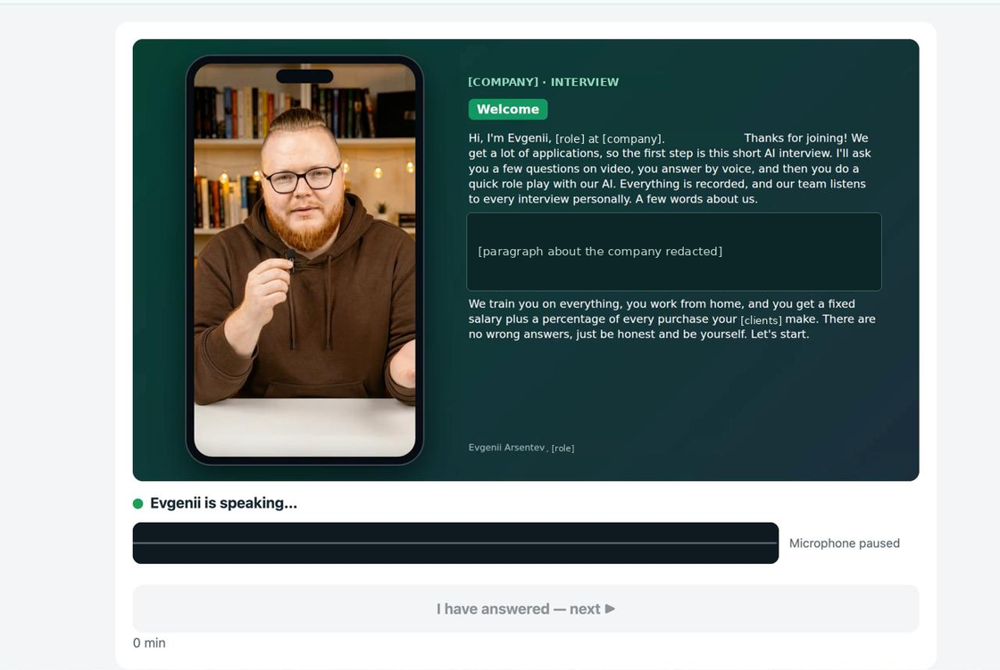
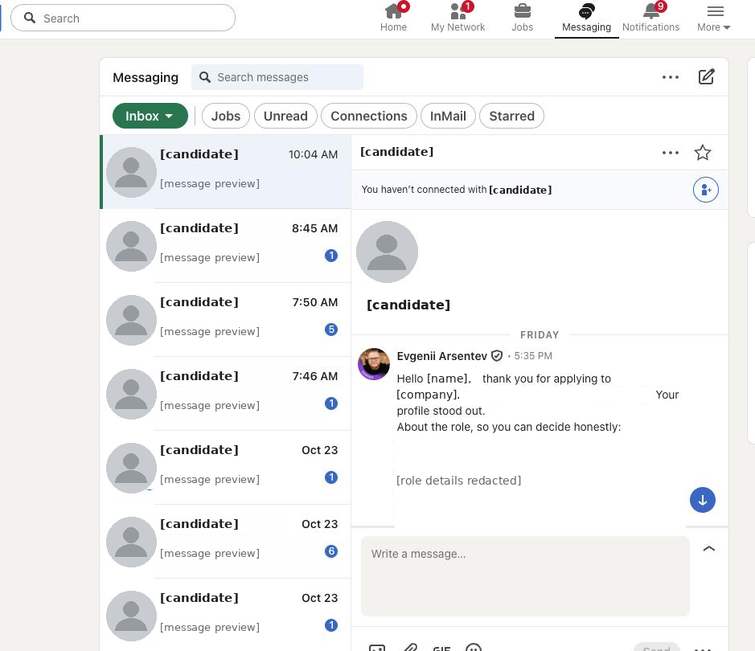

<p align="center">
  
</p>

<p align="center">
  <a href="https://doi.org/10.5281/zenodo.23927437"></a>
  <a href="https://doi.org/10.5281/zenodo.23979629"></a>
  <a href="LICENSE"></a>
  
  
  
</p>

**hireburn — open-source AI HR hunter: record your AI avatar once, reach candidates at a human pace, let the avatar run first interviews, and see where your funnel leaks.**

Part of the free Digital employees catalog: [arsentev.ai/employees](https://arsentev.ai/employees).

Three small tools that work together or alone:

- **`avatar`** — the record-once kit. A recording script and checklist, an interview plan of
  pre-recorded clips with *at most one* voice-AI follow-up per question, a candidate page that
  tells people they are talking to an AI avatar before they press Start, and a scoring rubric
  whose HIRE / MAYBE / NO label always ships with the warning that a label is not a measurement.
- **`outreach`** — LinkedIn outreach and follow-ups at a human pace. Personal drafts from a
  template and a hook *you* wrote after reading the profile, a queue with random pauses, hourly
  and daily caps and working hours, a STOP switch for the first warning or captcha, and a reply
  tracker. **A person presses "send". hireburn never does.**
- **`funnel`** — where the hiring funnel leaks: losses per stage, show-up rate, completion rate,
  days to first real work, AI label against who is still working on day N, and a disclosure
  checklist measured against NYC Local Law 144, the Illinois AI Video Interview Act, Illinois
  HB 3773 and the EU AI Act.

Python 3.10+, standard library only, CSV / YAML / JSON in, Markdown and JSON out. Nothing leaves
your machine: hireburn makes no network calls.

## Why

- **People put off recording an avatar.** They picture a studio. You need a window, a phone and
  twenty minutes — once. After that the avatar asks every candidate the same questions in the
  same words, which is what makes first interviews comparable.
- **An AI interview label is not a measurement.** In the case this method comes from, the labels
  of an AI interview did not line up with who was still working weeks later
  ([report](https://doi.org/10.5281/zenodo.23927437), [story](https://dev.to/arsentev/ai-hiring-in-a-live-company-the-agent-filled-the-funnel-the-ai-interviews-labels-did-not-line-up-54ef)).
  hireburn puts the label next to the outcome so you can check it on your own people.
- **The funnel leaks where nobody looks.** No-shows, bookings nobody updated, people who got an
  account and never started, decisions that sat for weeks. Stage counts turn that into numbers.
- **Telling candidates is the feature.** Disclosure, consent, a human alternative and human review
  are built into the page and the rubric, so the compliant path is the default path.
- **Outreach bots get accounts restricted.** We hit a LinkedIn restriction when the pace was not
  human; that is why the default limits are where they are.

## Quickstart in 60 seconds

**Easiest: ask your coding agent.** Paste this to Claude Code (or any coding agent) and answer its questions about the role; it follows [AGENTS.md](AGENTS.md):

> Install hireburn from github.com/arsentev-ai/hireburn and set it up for my vacancy: ask me about the role, write my avatar recording script, build the candidate page with AI disclosure, and plan LinkedIn outreach at a human pace.

Or by hand:

```bash
git clone https://github.com/arsentev-ai/hireburn && cd hireburn
python3 -m hireburn demo                 # no install, no dependencies: runs all three parts
```

Or install the command and run each part on the synthetic example company:

```bash
pip install .
hireburn funnel   examples/example-company/funnel.csv
hireburn labels   examples/example-company/candidates.csv --day 30 --snapshot 60
hireburn avatar   script examples/example-company/interview.yaml > recording-script.md
hireburn avatar   page   examples/example-company/interview.yaml --rubric examples/example-company/rubric.yaml -o page.html
hireburn outreach draft  examples/example-company/outreach.csv --templates examples/example-company/templates.yaml -o drafts.json
hireburn outreach plan   drafts.json -o queue.json
```

Docker: `docker build -t hireburn . && docker run --rm hireburn` runs the demo.

## Demo

<p align="center">
  
</p>

Everything in the demo is synthetic: an invented "example company" with round numbers. No real
company, candidate or vendor appears in the demo, the examples or the code.

## See it in action

Two screenshots from a real hiring run. They are not mock-ups. Company details, candidates' names,
photos and messages are covered with solid boxes before publishing.

<p align="center">
  
</p>
<p align="center"><em>A first interview run by a recorded AI avatar — the author's own avatar; company details redacted.</em></p>

<p align="center">
  
</p>
<p align="center"><em>Outreach replies in LinkedIn — candidates' names, photos and company details redacted; every message was sent by a person.</em></p>

## How it works

```text
 1  RECORD ONCE                 2  REACH AT A HUMAN PACE           3  FIRST INTERVIEW               4  MEASURE
 ┌──────────────────┐          ┌──────────────────────────┐     ┌──────────────────────────┐     ┌──────────────────────┐
 │ avatar checklist │          │ outreach draft           │     │ candidate page           │     │ funnel               │
 │ avatar script    │          │   template + your hook   │     │   "you are talking to    │     │   loss per stage     │
 │   (every clip,   │          │ outreach plan / run      │     │    an AI avatar"         │     │   show-up rate       │
 │    disclosure    │──clips──▶│   pauses · caps · hours  │────▶│   consent gate           │────▶│   completion rate    │
 │    first)        │          │   a PERSON presses send  │link │   clips + ≤1 AI          │     │   days to first work │
 └────────┬─────────┘          │   STOP on first warning  │     │   follow-up per question │     │ labels vs working    │
          │                    │ outreach track           │     ├──────────────────────────┤     │   on day N           │
          ▼                    │   follow-ups · DNC list  │     │ rubric → HIRE/MAYBE/NO   │     │ disclosure checklist │
  your avatar provider         └──────────────────────────┘     │   + "not a measurement"  │     └──────────────────────┘
  (pluggable, no keys here)                                     │   + human review for NO  │
                                                                └──────────────────────────┘
```

### 1. `avatar` — record once

| command | what you get |
|---|---|
| `hireburn avatar checklist` | consent and likeness, light, sound, framing, delivery, clip lengths |
| `hireburn avatar script interview.yaml` | every clip the avatar says: an opening that discloses the avatar, one clip per question, transitions, closing, three fallbacks; warns when a clip runs long |
| `hireburn avatar plan interview.yaml` | player steps: consent → clips → answer → *optional* follow-up (max 1) → … |
| `hireburn avatar page interview.yaml -o page.html` | a single-file candidate page; refuses to build without the disclosure facts |
| `hireburn avatar score t1.json t2.json --rubric rubric.yaml --scorer my.module:MyScorer` | HIRE / MAYBE / NO per transcript, weighted score, who needs human review |

Why one follow-up and no more: the avatar is a recording, so every candidate hears the same
question. A live voice AI gets one short clarification per question; more than that turns a
structured interview into a different conversation for each person.

The opening clip says it plainly, in your voice:

```text
Hi, I'm Alex Example, Head of Support at Example Company (synthetic). Before we start, one thing
you should know: the person on this screen is an AI avatar made from my recordings. You are not
talking to me live. Short follow-up questions come from a voice AI. A person on our team reads
every answer — the AI does not decide on its own. ...
```

**Bring your own providers.** hireburn ships interfaces, not integrations: `AvatarRenderer`,
`VoiceAgent`, `Transcriber`, `Scorer` in [`hireburn/avatar/providers.py`](hireburn/avatar/providers.py).
Write a small class for whichever avatar, voice or model service you use, read its key from your
environment, and pass `--scorer package.module:ClassName`. `ManualScorer` takes scores typed by a
person. `KeywordDemoScorer` exists only so the demo runs offline — it is not an assessment and
must not be used on real people. Rubrics that mention tone, emotion, accent or face are refused:
score the content of the answers.

### 2. `outreach` — a human pace, a human hand

| command | what it does |
|---|---|
| `hireburn outreach draft cards.csv --templates templates.yaml` | personal drafts; a card without a `hook` (one sentence you wrote after reading the profile) is refused; `do_not_contact` is skipped; length and spam lint |
| `hireburn outreach plan drafts.json` | view profile → pause → send, spread over working hours with random gaps and caps |
| `hireburn outreach run queue.json --drafts drafts.json [--open]` | shows the next profile and draft when the pace allows; **you** send and press `d`; `w` = "I saw a warning" stops everything |
| `hireburn outreach stop --reason captcha` / `resume --account-checked` | STOP file with a 48-hour cool-down |
| `hireburn outreach track replies.csv` | reply rate, follow-ups due (day 4, day 10, max two), do-not-contact list |

Default limits, conservative on purpose:

| limit | default |
|---|---|
| messages | ≤ 10 per hour, ≤ 40 per day |
| profile views | ≤ 30 per hour, ≤ 120 per day |
| connection requests | ≤ 8 per hour, ≤ 25 per day |
| all sends together | ≤ 10 per hour (hireburn refuses more than 20) |
| pause between actions | random 20–60 s plus millisecond jitter; 45–150 s between viewing a profile and writing |
| longer break | 5–15 min every 8 actions |
| hours | 9:00–18:00, weekdays |
| after a warning or captcha | everything stops; resume after 48 h and only once you confirm the account is fine |

The queue checks the real log of what was done, not the plan, so the caps hold even if the plan
is old or two queues run at once.

**What hireburn will not do:** log in, click, type or send on LinkedIn; run a headless browser;
scrape profiles; rotate proxies or fingerprints; get around rate limits or detection. LinkedIn's
User Agreement prohibits bots and automated messaging, and so does this project. Send through
LinkedIn yourself, or through an official channel you are licensed to use.

### 3. `funnel` — where it leaks

```text
$ hireburn funnel examples/example-company/funnel.csv

| stage                            | count | from previous | lost here | of first stage |
| -------------------------------- | ----: | ------------: | --------: | -------------: |
| applications                     | 3,000 |             — |           |         100.0% |
| screened                         | 1,200 |         40.0% |     1,800 |          40.0% |
| candidates                       |   300 |         25.0% |       900 |          10.0% |
| booked                           |   120 |         40.0% |       180 |           4.0% |
| held                             |    90 |         75.0% |        30 |           3.0% |
|   ↳ no_show (of booked)          |    20 |         16.7% |           |                |
|   ↳ cancelled (of booked)        |     5 |          4.2% |           |                |
|   ↳ ai_invited (of candidates)   |    60 |         20.0% |           |                |
|   ↳ ai_completed (of ai_invited) |    40 |         66.7% |           |                |
| accounts                         |    34 |         37.8% |        56 |           1.1% |
| started                          |    24 |         70.6% |        10 |           0.8% |
| working_day_30                   |    18 |         75.0% |         6 |           0.6% |

- show-up rate = held ÷ (held + no-show): 81.8%
- completion rate = completed ÷ invited: 66.7%
- ⚠ 5 bookings are neither held, no-show nor cancelled — usually a status nobody updated.
  Treat held and no-show counts as lower bounds.
```

| command | formula / output |
|---|---|
| `hireburn funnel funnel.csv` | loss per stage; show-up = held ÷ (held + no-show); completion = completed ÷ invited |
| `hireburn labels candidates.csv --day 30` | per AI label: candidates, accounts, started, working on day N; HIRE vs MAYBE two-sided Fisher exact test; AI label × human result |
| `hireburn labels … --snapshot 60` | median days entry → first real work, plus an equal-window view (within 7 / 14 days), because medians over starters favour late entrants |
| `hireburn disclosure disclosure.yaml --page page.html` | yes / partly / no per requirement; page markers checked; `--strict` exits 2 on any "no" |

The disclosure checklist is a yardstick, **not legal advice**. It lists requirements from
[NYC Local Law 144](https://www.nyc.gov/site/dca/about/automated-employment-decision-tools.page)
(bias audit, notice 10 business days ahead, alternative process), the
[Illinois AI Video Interview Act](https://www.ilga.gov/legislation/ilcs/ilcs3.asp?ActID=4015&ChapterID=68)
(notice, explanation, consent, limited sharing, deletion within 30 days), Illinois HB 3773
(notice, no discriminatory effect, no ZIP-code proxies) and the
[EU AI Act](https://eur-lex.europa.eu/eli/reg/2024/1689/oj) (hiring is high-risk under Annex III;
telling people they interact with AI; human oversight; no emotion inference at work). Whether a
rule applies to you depends on where the role and the candidate are — ask counsel.

## Inputs

All formats are documented at the top of each module and shown in
[`examples/example-company`](examples/example-company):

| file | used by |
|---|---|
| `funnel.csv` — `stage,count,parent,role` | `funnel` |
| `candidates.csv` — `id,entered,ai_label,human_label,account,first_work,working_day_n` | `labels` |
| `disclosure.yaml` — `answers: {id: {status, note}}` | `disclosure` |
| `interview.yaml` — company, role, interviewer, alternative contact, retention, questions | `avatar script / plan / page` |
| `rubric.yaml` — thresholds and weighted criteria with anchors | `avatar score` |
| `outreach.csv` + `templates.yaml` | `outreach draft` |
| `replies.csv` | `outreach track` |

YAML is read by a small built-in parser (maps, lists, quoted strings, block text, inline
`[...]` and `{...}`); for anything fancier use JSON.

## Limits

- The method comes from one company's case. hireburn makes the numbers easy to
  compute on yours; it does not tell you which candidates will work out.
- Small groups give wide uncertainty. The Fisher test is printed so a 10-point gap between two groups
  of ten is not mistaken for a finding.
- The candidate page is a starting point: put it behind your own upload endpoint, check it with
  `hireburn disclosure --page`, and have counsel read it before real use.

## Cite

The method comes from the payrollburn case report on AI hiring in a live company:

> Arsentev, E. (2026). *AI Hiring in a Live Company: A 36-Day Case Study of an AI Hiring Agent and an AI Interview* (payrollburn, part 2 of
> "AI managers in a live company"). Zenodo. https://doi.org/10.5281/zenodo.23927437

GitHub's **"Cite this repository"** button gives the reference for the software; metadata is in
[`CITATION.cff`](CITATION.cff) and [`codemeta.json`](codemeta.json). Write-up for practitioners:
[DEV.to](https://dev.to/arsentev/ai-hiring-in-a-live-company-the-agent-filled-the-funnel-the-ai-interviews-labels-did-not-line-up-54ef) ·
research page: [arsentev.ai/research/ai-hiring](https://arsentev.ai/research/ai-hiring).

## Author

Evgenii Arsentev, MD, PhD — author of [contextburn](https://github.com/arsentev-ai/contextburn) and
the payrollburn case series; Founder & CEO, Dad4Kids ·
[arsentev.ai](https://arsentev.ai) · ORCID [0000-0002-9120-7298](https://orcid.org/0000-0002-9120-7298)

## License

MIT — see [LICENSE](LICENSE).
